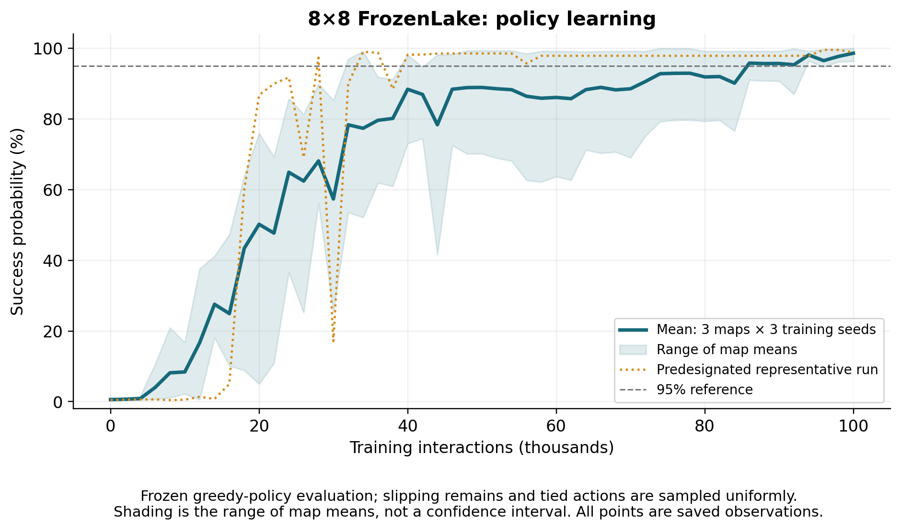
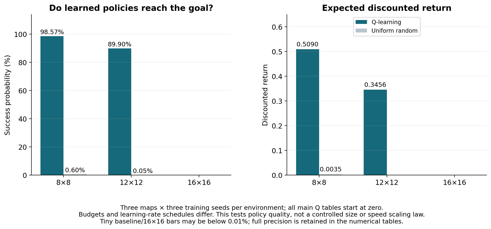
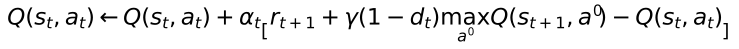
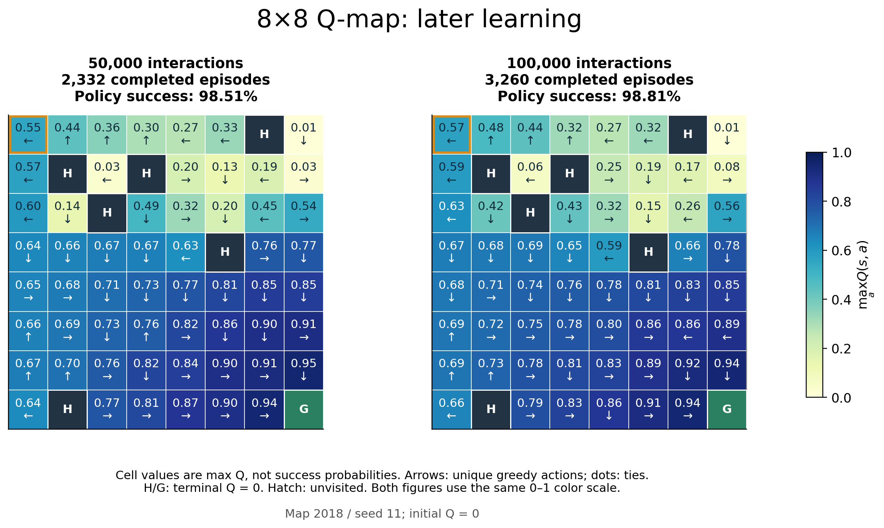

# Learning Policies on FrozenLake

**Can Q-learning learn useful navigation policies when movement is uncertain?**

This ESTR2018 project models FrozenLake as a finite Markov decision process
(MDP) and learns tabular action values from sampled experience. We test 8×8,
12×12 and 16×16 lakes. The aim is policy effectiveness, rather than a controlled
comparison of training speed across grid sizes.



## Results

Each main result is the mean of **nine independent training runs: three maps ×
three training seeds**. Every baseline starts with **Q₀ = 0**. The table uses
frozen-policy success probabilities computed from the environment model;
independent Monte Carlo evaluation is also retained. Slipping remains enabled.

| Lake | Interactions per run | Mean policy success | Uniform random | Additional-map check |
| --- | ---: | ---: | ---: | ---: |
| 8×8 | 100,000 | 98.57% | 0.60% | 92.74% |
| 12×12 | 1,000,000 | 89.90% | 0.05% | 49.22% |
| 16×16 | 500,000 | 0.0024% | 0.0021% | 0.0009% |

The 8×8 mean rises from **88.89% at 50,000 interactions** to
**98.57% at 100,000** within the same runs. The
predesignated example has **98.81%** exact
success and **98.86%** success over 5,000
independent evaluation episodes. One example is not the nine-run mean.

The 16×16 baseline remains close to random under its stated budget. Its nine
main runs discover only **7 goal rewards**, and **4 final Q
tables remain zero**. This is an observed limitation of this preset, not proof
that every 16×16 lake is unsolvable with Q-learning.



**Interpretation matters:** budgets, learning-rate schedules and episode cutoffs
differ by size. Additional-map checks retrain from scratch; they do not test
direct transfer of one policy to unseen maps. The report describes these limits.

## Task and method

The agent starts in the upper-left and aims for the lower-right goal while
avoiding holes. A chosen action moves in the intended direction or either
perpendicular direction with probability 1/3 each. Boundary moves stay in place.
Entering the goal pays +1 once; every other transition pays 0. Goal and hole
states terminate an episode.

Q-learning updates one state–action entry per interaction. It does not read a
transition expectation or use the separately computed evaluation as training
feedback. Training uses ε-greedy exploration; evaluation freezes Q and removes
ε exploration, with uniform tie-breaking among maximal actions.



The terminal indicator dₜ is one only at the goal or a hole. External time-limit
truncation retains bootstrapping. Q-map colors show estimated discounted return,
not success probability.



## Project layout

```text
src/frozenlake/     configuration, environments, learner, evaluation and CLI
config/            three baselines and a matched optimistic-16 control
figure/            curated PNG/SVG assets used by these documents
test/              numerical, protocol and browser checks
gui/               read-only checkpoint and four-action Q-table viewer
docker/            pinned training environment
results/baseline/  configurations, logs, Q snapshots, evaluations and provenance
report/            experiment report and presentation text
references/        bibliography, course instructions and the replay paper
```

There is one training implementation. Historical alternative implementations,
parameter searches and duplicate images are excluded from the active project.

## Setup

Install [uv](https://docs.astral.sh/uv/getting-started/installation/) (0.13.8 or
later), then sync the locked environment. The project supports Python 3.10–3.12;
`.python-version` selects 3.10 for local analysis and the viewer.

```bash
uv sync --locked
uv run --locked python -m unittest discover -s test -v
```

`pyproject.toml` declares dependencies and `uv.lock` pins their resolved versions.
Commit both files together. The `train` dependency group pins JAX 0.5.3 and NumPy
1.26.4 for the training container; the default sync installs the analysis/viewer
environment. Docker synchronizes only the training group from the same lock.
The `run` command starts training inside that container.
Use `uv add <package>` to add a dependency and `uv lock --upgrade-package <package>`
to deliberately update one. See [uv locking and syncing](https://docs.astral.sh/uv/concepts/projects/sync/).

Build the training environment once, then use a **new output directory**:

```bash
uv run --locked frozenlake runtime
uv run --locked frozenlake run --config config/baseline_8.json --output results/runs/example_8
uv run --locked frozenlake verify --output results/runs/example_8
uv run --locked frozenlake plot --output results/runs/example_8 --figures results/runs/example_8/figure
```

After a result has been verified, `publish --output <directory>` registers it in
the read-only viewer. `uv run --locked frozenlake report` regenerates this
README, the report and summary figures from the published catalog.

The runtime requires a CUDA-capable NVIDIA device and NVIDIA Container Toolkit.
The retained runs used an RTX 4090 D, JAX 0.5.3 and float64 action values. The
runtime builder can start from a local cached image or a public Python base.
Both paths run `uv sync --locked --only-group train` before training. Container
commands use `sg docker -c` and execute as the host UID/GID. The repository mount
is read-only and result files are owned by the host user.

Existing results are protected from overwriting. `prepare`, `train`, `evaluate`,
`verify` and `publish` are also available as separate stages. Run
`uv run --locked frozenlake --help` for the command list.

## Inspect a policy

```bash
uv run --locked frozenlake view
```

Open **http://127.0.0.1:8765/gui/**. Choose a lake, move through checkpoints,
switch between maximum Q and any of the four action values, and select a cell
to inspect full-precision values and visit counts. This viewer is read-only.

## Planned 16×16 control

The baseline remains zero-initialized. The separate optimistic configuration
inherits the same maps, seeds, dynamics, budget and schedules, changing only the
nonterminal initial Q value. It is **not included in the published baseline**.

```bash
uv run --locked frozenlake run --config config/optimistic_16.json --output results/optimistic/16x16
uv run --locked frozenlake verify --output results/optimistic/16x16
uv run --locked frozenlake compare --baseline results/baseline/16x16 --candidate results/optimistic/16x16 --output results/optimistic/comparison
```

The comparison rejects changed maps, schedules, budgets or training code, and
writes paired results. After verification, publish the candidate to add it as a
separate viewer entry and include the matched result in a regenerated report.
Replay and DQN remain later research options; neither is an implemented solution.

No matched optimistic-control result is published yet. The configured control is future work, not a measured improvement.

## Evidence and documents

- [Experiment report](report/report.md): probability model, protocol, numerical
  results, measured timing, limitations and the next experiment.
- [Presentation text](report/presentation.md): bilingual material for a title and
  five content slides.
- [Published experiment catalog](results/catalog.json): links to the raw results.
- Each result has `config.json`, `runs.json`, `inputs.npz`, `snapshots.npz`,
  `final_state.npz`, `evaluation_curve.csv`, `summary.csv`, `aggregate.json`,
  runtime/provenance manifests and a verification record. Per-run folders retain
  every completed episode and the full final four-action `q_table.csv`.

## References

- Watkins and Dayan (1992), [Q-learning](https://doi.org/10.1007/BF00992698).
- Sutton and Barto (2018), [Reinforcement Learning: An Introduction](https://mitpress.mit.edu/9780262039246/reinforcement-learning/), 2nd ed.
- Farama Foundation, [FrozenLake specification](https://gymnasium.farama.org/environments/toy_text/frozen_lake/).
- We also consulted [Stanford CS234: Reinforcement Learning](https://web.stanford.edu/class/archive/cs/cs234/cs234.1264/modules.html), especially Lectures 2 and 4.
- The 100-episode moving-average plot was informed by the [Sesen.ai FrozenLake tutorial](https://sesen.ai/blog/q-learning-frozen-lake-from-scratch); its 4×4 results and training budgets are not our results.
- Full citations, including planned replay/DQN references, are in [references.bib](references/references.bib).
