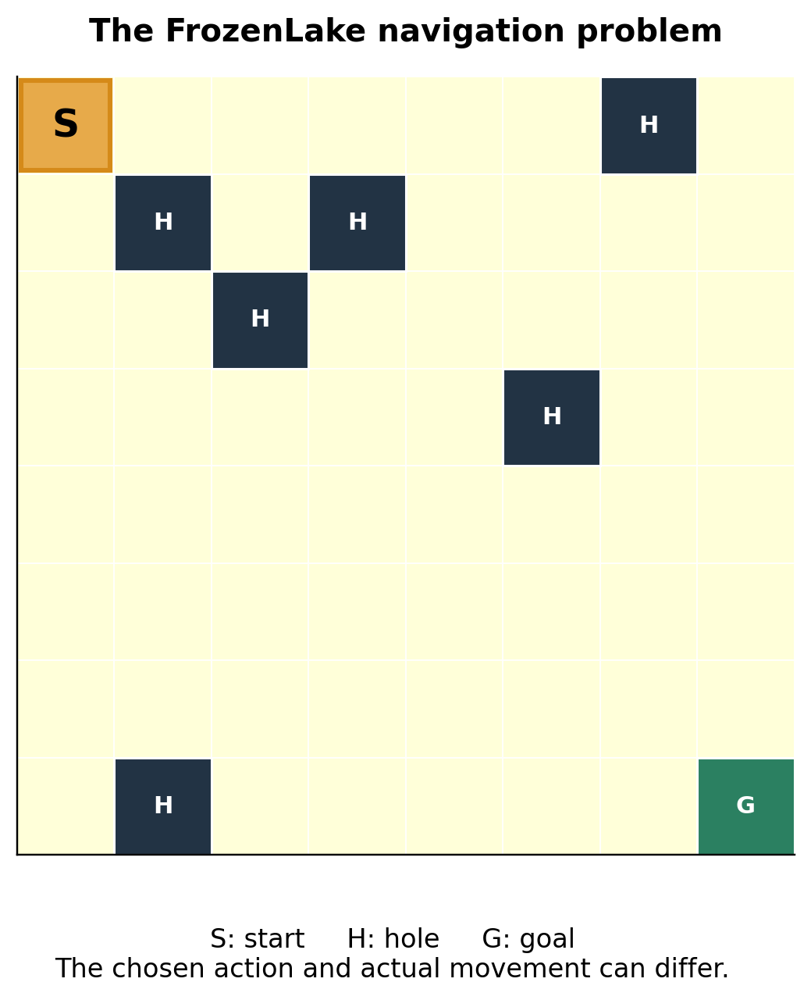
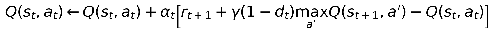
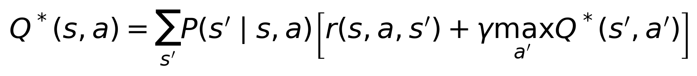
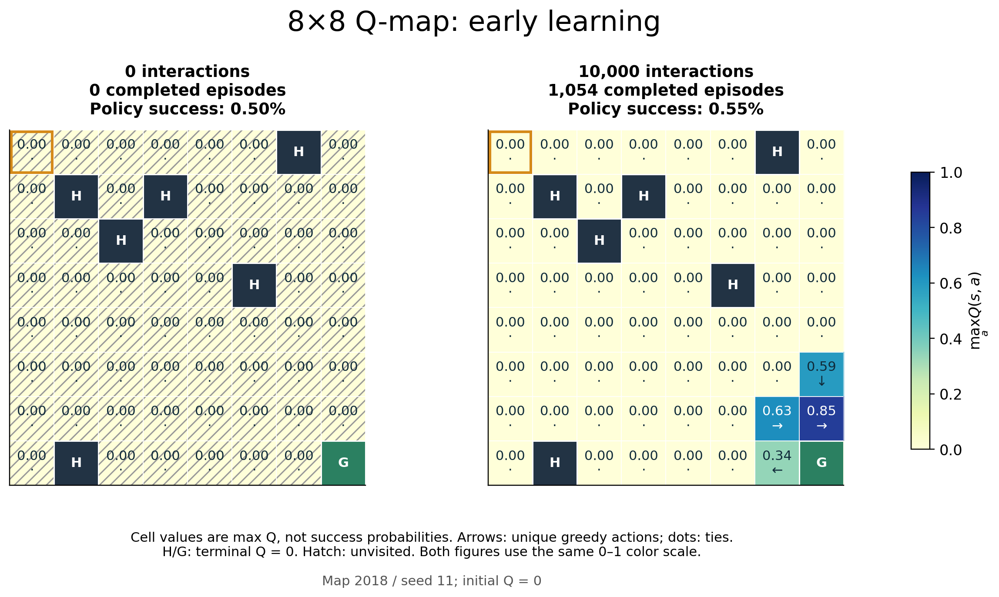
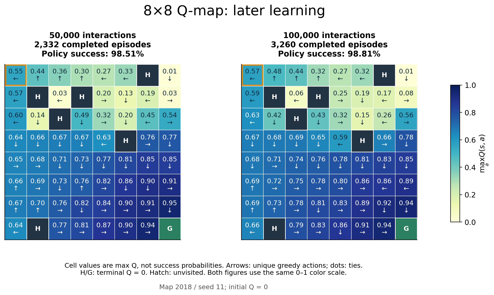
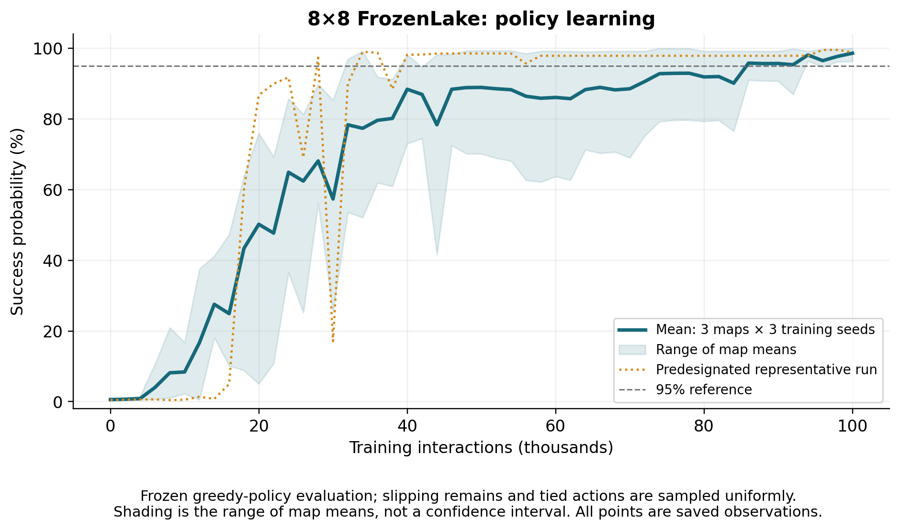
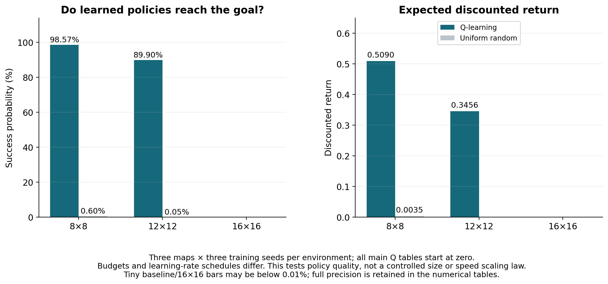

# Markov Decision Process (MDP) in Reinforcement Learning
# 强化学习中的马尔可夫决策过程

Q-Learning for Stochastic FrozenLake Navigation

---

## 1. Introduction / 问题介绍

An agent must reach a goal while avoiding holes on slippery ice. We model this
as an MDP and investigate whether Q-learning learns a useful policy from
interaction in 8×8, 12×12 and 16×16 environments.

智能体需要在会打滑的冰面上避开冰洞、到达终点。我们将任务建模为MDP，使用Q-learning研究智能体能否通过交互学到有效策略，并准备8×8、12×12、16×16三类环境。

Reference: [FrozenLake specification](https://gymnasium.farama.org/environments/toy_text/frozen_lake/).

---

## 2. MDP and Q-Learning / 模型与算法

- State: current cell. Actions: left, down, right, up.
- Intended and two perpendicular directions each have probability 1/3; boundary moves stay in place.
- Entering the goal pays +1, otherwise 0. Goal/hole terminate. Baseline Q₀=0.
- ε-greedy exploration; one observed transition updates one state–action value.

状态为当前位置，动作是四个方向。预期方向及两个垂直方向各1/3；越界留原地。进入终点奖励1，其他0；终点/冰洞结束回合。主实验Q₀=0，使用ε-greedy探索。

Watkins & Dayan (1992), §2. [DOI](https://doi.org/10.1007/BF00992698). We also consulted [Stanford CS234](https://web.stanford.edu/class/archive/cs/cs234/cs234.1264/modules.html).

---

## 3. Our Experiment / 实验过程

| Setting / 设置 | Value / 数值 |
| --- | --- |
| Initialization / 初始化 | Q₀=0 |
| Training budget / 预算 | 100,000 interactions per run |
| Learning rate / 学习率 | α=.7 until 37,500 interactions, then .1 |
| Discount / 折扣 | γ=.99 |
| Exploration / 探索 | ε: 1.00 to .05 over 25,000 interactions |

Nine-run mean exact success: **98.57%** (3 maps × 3 training seeds).
Predesignated policy: **98.81%** exact success;
**98.86%** over 5,000 independent evaluation episodes.

九次运行平均精确成功概率为98.57%。图上数字为最大Q值，不是成功概率；箭头表示选择动作，实际移动仍会打滑。

---

## 4. Policy Assessment / 策略效果

| Lake | Interactions/run | Mean exact success | Uniform random | Additional-map check |
| --- | ---: | ---: | ---: | ---: |
| 8×8 | 100,000 | 98.57% | 0.60% | 92.74% |
| 12×12 | 1,000,000 | 89.90% | 0.05% | 49.22% |
| 16×16 | 500,000 | 0.0024% | 0.0021% | 0.0009% |

Different budgets and schedules are disclosed; these are task examples, not a
pure grid-size comparison. Policies are retrained on each map.

各环境使用不同预算与超参数，重点是策略是否有效，不将差异完全归因于地图大小；每张地图独立训练。

---

## 5. Limitations and Future Work / 局限与后续工作

- 16×16 receives **7 goal rewards across 4.5 million interactions**; **4/9** final Q tables stay zero.
- Sparse rewards and uneven visits restrict value propagation under this preset.
- The report's next experiment is matched optimistic initialization; the main baseline remains Q₀=0.
- Replay and DQN are later options, not implemented or established solutions here.

16×16的九次主训练共450万交互步，仅获得7次终点奖励，其中4次最终Q表全零。后续report将用匹配对照检验乐观初始化，再讨论回放和DQN；不预先保证能解决问题。

References: Sutton & Barto (2018), §2.6; [Schaul et al. (2016)](https://arxiv.org/pdf/1511.05952); [Mnih et al. (2015)](https://doi.org/10.1038/nature14236).
