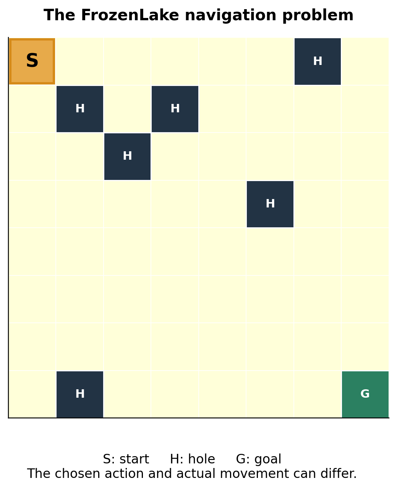
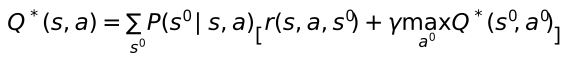
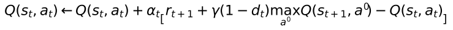
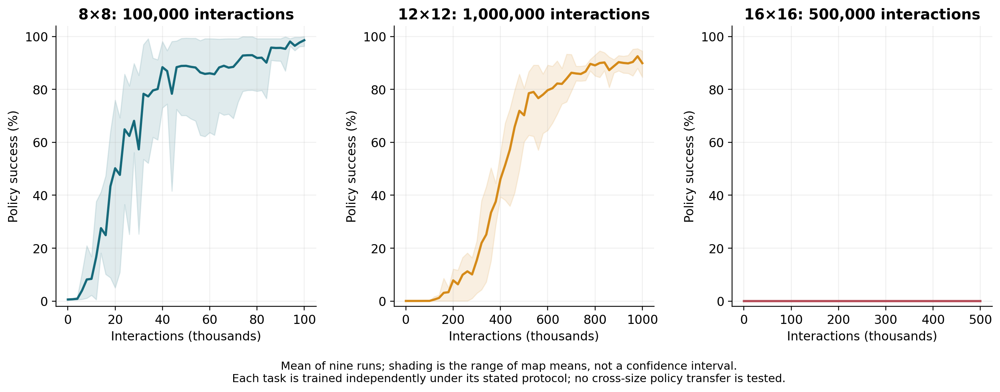
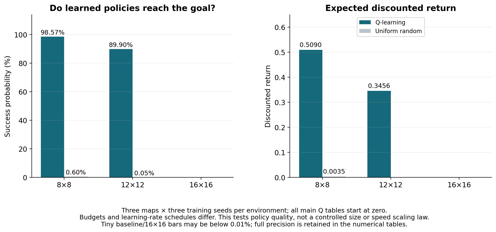
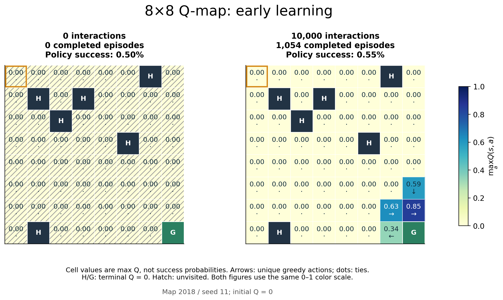
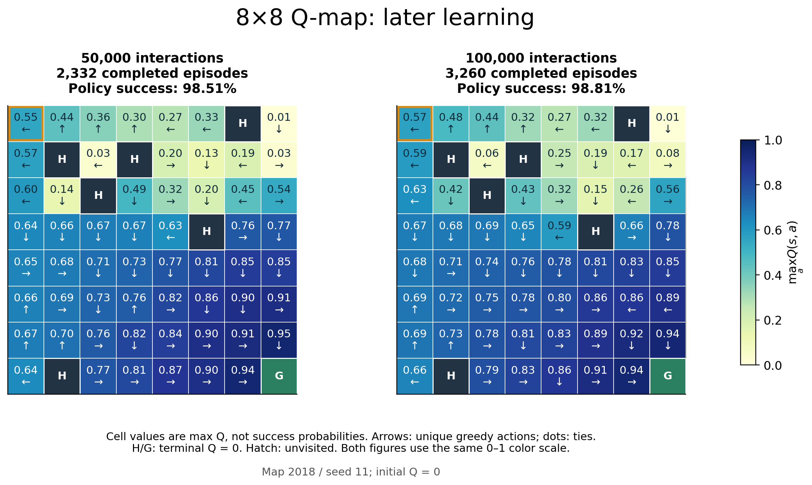
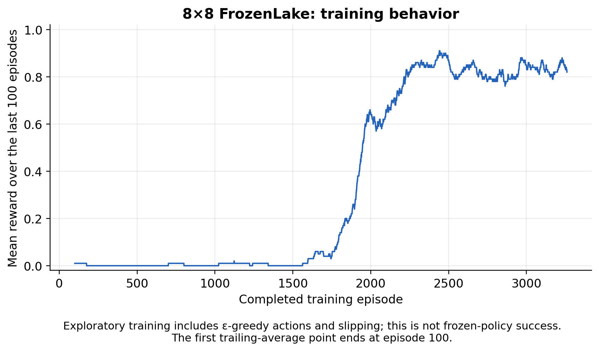
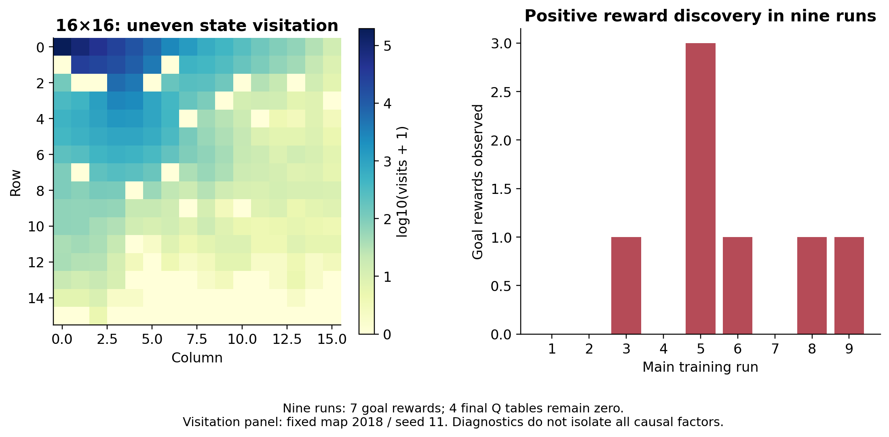

# Learning Navigation Policies on Stochastic FrozenLake

**ESTR2018 — Markov Decision Processes in Reinforcement Learning**

## Abstract

We investigate whether one-step tabular Q-learning can learn useful policies
from interaction in stochastic FrozenLake environments. Three map sizes are
used as task examples, with separately specified budgets and learning-rate
schedules. All main Q tables start at zero. The main-map mean final success
probabilities are 98.57%, 89.90%
and 0.0024% for 8×8, 12×12 and 16×16 respectively.
The largest baseline discovers little positive feedback. We retain raw logs,
action-value checkpoints, model-based policy evaluation, independent sampled
evaluation and timing. A matched optimistic-initialization control is configured
as a separate experiment; it does not alter the zero-initialized baseline table.

## 1. Research question

Can an agent learn an effective navigation policy through experience when its
actions have uncertain outcomes? The three sizes provide environments in which
to examine learning and failure. The contribution is a transparent implementation
and preliminary numerical study, not a new algorithm or a universal scaling law.

The project follows Topic 10 of the [course instructions](../references/project_instructions.pdf).
MDP and Q-learning background follows Watkins and Dayan [1], Sutton and Barto [2],
and the [Stanford CS234 materials](https://web.stanford.edu/class/archive/cs/cs234/cs234.1264/modules.html).

## 2. Problem formulation and probability

The current cell is the state; actions are left, down, right and up. The lake
contains a start S, safe cells F, terminal holes H and terminal goal G. The start
is upper-left and the goal lower-right. Maps use a fixed rounded hole count,
`round(0.10 × (n² − 2))`, giving 6, 14 and 25 holes. Generation rejects maps
without a hole-free path; connectivity does not guarantee safe execution.

For an action pointing right, actual right, up and down movement each have
probability 1/3. Other actions have the analogous perpendicular alternatives.
Out-of-bounds movement remains in place, so multiple branches may merge. For
example, at the upper-left corner, choosing left stays with probability 2/3 and
moves down with probability 1/3. Thus arrows toward a boundary can be purposeful.
Transition and reward semantics are taken from Gymnasium 1.4.0 [3].

Entering G pays +1 once; other transitions pay zero. G and H terminate. The
objective is expected discounted return: immediate reward plus gamma times the
continuation return, averaged over possible future outcomes. If the only reward
occurs on move T, that episode returns γ^(T−1). With γ < 1, this objective differs
from undiscounted success probability; both metrics are reported separately.

The Markov property makes the next-state distribution depend on the current
state and chosen action. Conditioning on that next state yields the Bellman
expectation, while selecting the best available continuation action yields the
Bellman optimality relation [1,2]. Q-learning approximates this relation from
individual samples, without a model expectation in its update.

## 3. Learning algorithm

Here dₜ is the true termination indicator. It is one at G/H, so there is no
continuation target after termination. The sampling cutoff H=4n² is external
truncation: it restarts sampling but does not remove the bootstrap term. The
current position is the policy observation; no shortest path, VI value or
evaluation score is provided to the learner.

Training uses ε-greedy actions and uniform tie-breaking among equally maximal
values. Each run has its own Q table, visits, state and random key. Independent
runs execute in parallel, without sharing transitions or values. Warmup and a
short numerical reference check are discarded before every learner is reset.
The single retained training implementation uses compiled JAX on CUDA; the
short CPU reference is a verification check, not an alternative training entry.

Q=0 is used in every published baseline. A zero table receiving only zero
rewards remains zero. This explains why sparse reward discovery is essential;
small TD errors by themselves do not establish successful learning.

## 4. Experimental protocol

| Lake | States | Q entries | Holes | Episode cutoff | Interactions/run | α | ε decay ends at |
| --- | ---: | ---: | ---: | ---: | ---: | --- | ---: |
| 8×8 | 64 | 256 | 6 | 256 | 100,000 | 0.7 → 0.1 at 37,500 | 25,000 |
| 12×12 | 144 | 576 | 14 | 576 | 1,000,000 | 0.1 | 800,000 |
| 16×16 | 256 | 1024 | 25 | 1024 | 500,000 | 0.1 | 400,000 |

All runs use γ=.99 and ε decreasing linearly from 1 to .05, then held at .05.
The 8×8 thresholds are absolute: α changes at 37,500 steps and ε reaches .05 at
25,000, including when the total budget is 100,000. A step is one environment
interaction and one Q update; a completed episode can contain many steps. The
representative 8×8 run completes 3,260 episodes.

Main cases use map seeds 2018/2019/2020 and training seeds 11/22/33: nine learned
policies, not nine maps and not one policy transferred between maps. A second
group uses maps 2021/2022/2023 and seeds 44/55/66, retraining from scratch. These
maps have been inspected during development, so this is a sensitivity check,
not a pristine held-out generalization benchmark.

Presets were informed by exploratory development before the retained runs.
Search cost is not included in the per-run interaction budget. We make no claim
that these are globally optimal parameters or minimum sufficient budgets.
Different budgets, schedules and cutoffs prevent attributing differences only
to grid size. All retained training results use the same implementation and
runtime; historical implementation variants are outside the active project.

At saved checkpoints, we freeze Q, remove ε exploration and propagate state
probability mass through H steps to evaluate policy success, failure, truncation,
discounted return and episode length. Environmental slipping remains. This
analytic model evaluation never changes Q. Final policies also have 5,000
independent Monte Carlo episodes; sampled fractions fluctuate around analytic
probabilities. Every configuration and source hash is retained with the run.

## 5. Numerical results

| Lake | Interactions/run | Mean exact success | Uniform random | Additional-map mean |
| --- | ---: | ---: | ---: | ---: |
| 8×8 | 100,000 | 98.57% | 0.60% | 92.74% |
| 12×12 | 1,000,000 | 89.90% | 0.05% | 49.22% |
| 16×16 | 500,000 | 0.0024% | 0.0021% | 0.0009% |

All aggregate means use nine runs. Curve shading is the range of three map
means after averaging training seeds within each map; it is not a confidence
interval treating nine runs as nine independent maps. The final recorded
checkpoint is used, rather than selecting each run's best intermediate score.

### 5.1 The 8×8 case

Within the same retained trajectories, mean success changes from
88.89% at 50,000 steps to 98.57% at 100,000.
The predesignated map 2018/seed 11 policy has 98.81%
analytic success and 98.86% success in 5,000
independent rollouts. The nine-run mean and representative example are different
statistics. The minimum main-run score is 94.97%;
a mean above 95% does not mean every run exceeds 95%.

Q-map numbers show max Q, not policy success probability. Dots mark tied actions;
hatched cells were unvisited. Terminal values remain zero because reward is paid
on entering G. Values and actions can change after useful behavior appears; a
similar-looking map does not prove exact convergence with a constant late rate.

The last figure is a trailing 100-completed-episode average of training reward,
inspired by the plotting style of [the Sesen.ai tutorial](https://sesen.ai/blog/q-learning-frozen-lake-from-scratch).
It includes ε exploration and is not frozen-policy success. The first point ends
at episode 100. No monotonic smoothing or fabricated intermediate measurements
are used. The tutorial's 4×4 setting and 20,000-episode budget are not our protocol.

### 5.2 The 16×16 limitation

The nine main runs receive **7 goal rewards in 4,500,000 interactions**,
with **4 final zero Q tables**. The baseline's final score remains close
to uniform random choice. This supports a finite-budget reward-discovery and
value-propagation limitation. It does not isolate exploration, learning rate,
map topology and budget as separate causal factors.

The table contains only 1,024 scalar action values, about 8 KiB in float64. Storage
capacity is not the demonstrated bottleneck. A transition with a goal reward
updates one action value once; enough relevant subsequent samples are needed
to make that information useful at the start. Repeated starts also concentrate
visits near the initial region. The complete visit arrays preserve that evidence.

Rare-event sampling also needs care: a finite evaluation can observe no
successes even when the model assigns a small nonzero success probability.
The analytic probabilities and sampled fractions are retained separately.

## 6. Measured runtime and reproducibility

| Lake | Parallel learners | Synchronized training compute (s) | Training, transfer, logs, snapshots (s) | Container wall time (s) |
| --- | ---: | ---: | ---: | ---: |
| 8×8 | 18 | 2.511 | 3.269 | 4.963 |
| 12×12 | 18 | 24.818 | 33.352 | 35.590 |
| 16×16 | 18 | 12.515 | 19.262 | 21.210 |

These are total batch times for 18 independent learners (nine main and nine
additional-map cases), not single-learner latency divided by 18. Device work is
synchronized before timers stop. Compilation, discarded warmup and the numerical
reference check are recorded separately in each manifest. Container wall time
includes startup and runtime initialization; plotting and host evaluation are
outside training compute. These observations do not establish a CPU/GPU speedup.

The recorded runtime uses an RTX 4090 D, JAX 0.5.3, float64 values and a non-root
host UID/GID. Raw manifests contain the exact versions and hardware. The runtime
builder can reuse the local dependency image or start from a public Python base.
Both paths synchronize the `train` dependency group from `uv.lock`; the new
environment workflow does not rewrite the recorded historical runs. The
repository mount is read-only during training.

Maps, configurations, probability arrays, source snapshots, random keys, complete
final state, episode logs and evaluation samples remain under `results/baseline`.
The [catalog](../results/catalog.json) identifies the published baseline directories.
The read-only viewer exposes every representative checkpoint and all four Q
values per selected cell. Baseline verification checks source/input hashes,
counts, schedules, terminal masks, returns, sampled evaluation and Q exports.

## 7. Next experiment: optimistic initialization on 16×16

The baseline stays Q₀=0. The proposed configuration is
[`config/optimistic_16.json`](../config/optimistic_16.json), inheriting the full
16×16 baseline and changing only its name, variant and nonterminal initial value
to one. Terminal Q stays zero. Because an episode pays at most one +1 reward,
one is a valid optimistic upper bound on discounted return. The exploration
idea follows Sutton and Barto, §2.6 [2]; it is not an algorithmic novelty claim.

No matched optimistic-control result is published yet. The configured control is future work, not a measured improvement.

Use the commands in
the README, verify both runs, then compare paired maps/seeds. The comparison
rejects changed dynamics, rewards, cutoffs, schedules, budgets and core learner
code. Report both success and discounted return, not only the metric that improves.

If rare successful transitions are discovered, uniform replay and then prioritized
replay [4] can test sample reuse. Replay cannot invent rewards never observed;
replaying zero-reward/zero-value samples alone may leave an uninformative table.
If a neural approximation is explored later, compare DQN [5] with a tabular-replay
baseline at the same interaction budget, and also record replayed samples, update
counts, compute and wall time. A neural network is not an established solution
to this small-table exploration problem. Replay and DQN are not implemented here.

## 8. Conclusions

The retained implementation learns useful policies in the smaller task examples,
while the 16×16 zero-initialized preset receives little informative reward and
remains ineffective under its budget. The additional-map group reveals sensitivity
to topology and training randomness. Results support learning under particular
conditions, not guaranteed convergence, unseen-map transfer or a universal
sample count. The next step is a matched initialization control, with all original
baseline evidence preserved.

## References

[1] C. J. C. H. Watkins and P. Dayan, “Q-learning,” *Machine Learning*, vol. 8,
pp. 279–292, 1992. [DOI](https://doi.org/10.1007/BF00992698).

[2] R. S. Sutton and A. G. Barto, *Reinforcement Learning: An Introduction*,
2nd ed., MIT Press, 2018. Ch. 3, §2.6 and §6.5.
[Book](https://mitpress.mit.edu/9780262039246/reinforcement-learning/).

[3] Farama Foundation, [FrozenLake documentation](https://gymnasium.farama.org/environments/toy_text/frozen_lake/), accessed Nov. 16, 2026.

[4] T. Schaul, J. Quan, I. Antonoglou and D. Silver, “Prioritized experience
replay,” ICLR, 2016, §3.2–3.4. [Paper PDF](https://arxiv.org/pdf/1511.05952) ·
[Local PDF](../references/prioritized_experience_replay_2016.pdf).

[5] V. Mnih et al., “Human-level control through deep reinforcement learning,”
*Nature*, vol. 518, pp. 529–533, 2015. Methods: Training algorithm for deep Q-networks.
[DOI](https://doi.org/10.1038/nature14236).

We also referred to [Stanford CS234: Reinforcement Learning, Winter 2026](https://web.stanford.edu/class/archive/cs/cs234/cs234.1264/modules.html)
for the MDP and Q-learning background. All reported numerical performance is
from the retained local experiments, not from these references.
